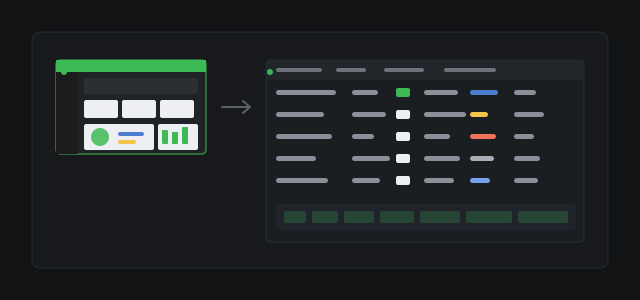

# dsh-figma-spec

A DeepSeek Harness plugin that reads a Figma frame's **real** style data over
the Figma REST API and renders it as something you can act on — a spec summary,
a full per-node CSV table, a type scale, a colour palette, or a diff between two
nodes.

Every value comes from the design file itself. Nothing is sampled from a
screenshot.



## What it returns

| Node property | Field |
|---|---|
| Box | `x`, `y`, `w`, `h` — frame-relative |
| Fill | solid hex, `#RRGGBB@opacity`, `linear(...)`, `radial(...)`, `image` |
| Stroke | colour plus `strokeSides: "bottom:1"` and `strokeAlign` |
| Radius | `r=8` (uniform) or `r4=1/1/0/0` (per corner) |
| Effects | `inner_shadow #FFFFFF a=0.31 offset=0,1` |
| Layout | `H gap=12 pad=6/12/6/12`, and `grid=12x12 cols=... rows=...` for GRID |
| Arc | `start`, `end`, `innerRadius` — for donut charts |
| Text | family, size, numeric weight, `lineHeightPx`, align, the copy itself |

## Tools

| Tool | Purpose |
|---|---|
| `figma_get_spec` | the whole frame: `summary` (default), `csv`, `markdown`, `tree` |
| `figma_get_typography` | type scale grouped by family / size / weight |
| `figma_get_palette` | distinct fills, strokes, effects by usage count |
| `figma_diff_nodes` | per-property diff between two nodes |

Start with `figma_get_spec` and `format: "summary"`. A 1920×1200 dashboard is
roughly 540 nodes; the full table is opt-in for a reason.

## Installation

The plugin is a standard DSH bundle: no dependencies, no build step, no install
scripts.

**From a local directory**

1. Clone this repository.
2. In DeepSeek Harness open **Plugins** → **Add plugin** and pick the cloned
   directory.

**As a profile dependency**

```json
{
  "dependencies": {
    "dsh-figma-spec": "github:cenweixin199/dsh-figma-spec"
  }
}
```

then add `"dsh-figma-spec"` to `dsh.profile.bundles` in the profile's
`package.json`.

## Configuration

### The token

The plugin needs a Figma **personal access token** with read access to the files
you inspect. Create one at <https://www.figma.com/settings> → *Personal access
tokens*.

**Recommended: use the settings page.** Open **Settings** → **Plugins** →
**Figma spec reader**, paste the token, and save. The page validates it
immediately and shows the account handle; the token itself is never echoed back.

**Or write the credential file directly** by adding `FIGMA_TOKEN` to the `refs`
section of the harness credential store.

Either way the token lives only in the local credential store: it is never
placed in `cordis.patch.yml`, never logged, and never written to the cache.

If the token is missing, the tools fail with a message explaining exactly what
to do. No partial or guessed output is returned.

### Plugin options

| Option | Default | Meaning |
|---|---|---|
| `cacheDir` | `$DSH_HOME/figma-spec-cache` | node cache directory |
| `maxRecords` | `600` | cap for csv / markdown / tree output |
| `cacheTtlHours` | `168` | how long a cached frame stays valid |

## Quota, and why the cache exists

Figma rate-limits the REST API per token and per plan tier, and the limits are
published in response headers (`x-figma-plan-tier`, `retry-after`). A
**Starter** account can be locked out of `/files/:key/nodes` for **more than a
day** after a handful of calls.

So the plugin:

- **caches** every fetched frame, and marks cached output with
  `_source: cached payload (saved …)` so you always know whether you are reading
  a fresh measurement;
- **does not retry** a lock longer than 300 s — it reports the plan tier and
  roughly how long the lock lasts instead of looping;
- **backs off** on genuine burst 429s at 2 s → 8 s → 32 s → 60 s.

## What it does not do

- **No code generation.** This reads specs; it does not produce React or HTML.
- **No writes to Figma** — no frames, components, variables, or comments.
- **No variable *names*.** Resolving variable ids to names requires Figma's
  Variables REST API, which is Enterprise-only. The plugin reports the ids it
  sees (`boundVariables`, `styles`) rather than inventing token names.
- **No screenshot fallback.** If the API is blocked, it says so; it will not
  guess values from a rendered image.

## The official Figma MCP server is a different product

`https://mcp.figma.com/mcp` is Figma's own hosted MCP server, authenticated with
OAuth. A personal access token returns **401** there — it authenticates
`api.figma.com` only. If you want design-to-code through the official server,
that is a separate integration; this plugin deliberately occupies the
"exact style spec" niche and does not compete with it.

## Development

```bash
node test/manifest.mjs     # manifest, locale, icon, module import
node test/regression.mjs   # normalize/render against a cached node payload
node test/cache.mjs        # cache hit/expiry/eviction, quota header parsing
node test/plugin.mjs       # plugin contract: tool and skill registration
FIGMA_TOKEN=... node test/live.mjs   # end-to-end against the live API
```

`test/regression.mjs` reads a cached node payload and asserts 538 records,
146 text nodes, and specific measured values (a bottom-only inside stroke, a
`[1,1,0,0]` bar radius, an `0.667` donut inner radius) so a regression in the
normalizer is caught without a network call.

## Licence

MIT. The icon is the Figma logo, used to identify the integration.

---

中文文档：[README.md](README.md)