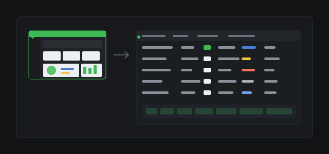

# Figma 设计稿规格读取

读取 Figma 画板的**真实**样式数据，并整理成可直接使用的规格：规格摘要、逐节点 CSV 表、字号体系、色板，或两个节点的差异对比。

每一个数值都来自设计文件本身，没有任何一项是从截图里采样出来的。



## 它返回什么

| 节点属性 | 字段 |
|---|---|
| 盒模型 | `x`、`y`、`w`、`h`（相对画板） |
| 填充 | 纯色十六进制、`#RRGGBB@不透明度`、`linear(...)`、`radial(...)`、`image` |
| 描边 | 颜色 + `strokeSides: "bottom:1"` + `strokeAlign` |
| 圆角 | `r=8`（统一）或 `r4=1/1/0/0`（逐角） |
| 效果 | `inner_shadow #FFFFFF a=0.31 offset=0,1` |
| 布局 | `H gap=12 pad=6/12/6/12`；GRID 为 `grid=12x12 cols=... rows=...` |
| 圆弧 | `start`、`end`、`innerRadius`（环形图） |
| 文字 | 字体、字号、字重、`lineHeightPx`、对齐、文案本身 |

## 工具

| 工具 | 用途 |
|---|---|
| `figma_get_spec` | 整块画板：`summary`（默认）、`csv`、`markdown`、`tree` |
| `figma_get_typography` | 按字体 / 字号 / 字重分组的字号体系 |
| `figma_get_palette` | 去重后的填充、描边、效果，按使用次数排序 |
| `figma_diff_nodes` | 两个节点之间的逐属性差异 |

第一次请用 `figma_get_spec` 加 `format: "summary"`。一块 1920×1200 的仪表盘大约 540 个节点，完整表格是刻意设计成需要显式请求的。

## 安装

本插件是标准 DSH bundle：零依赖、零构建步骤、无安装脚本。

**从本地目录安装**

1. 克隆本仓库。
2. 在 DeepSeek Harness 打开 **插件** → **添加插件**，选择克隆下来的目录。

**作为 profile 依赖**

```json
{
  "dependencies": {
    "dsh-figma-spec": "github:cenweixin199/dsh-figma-spec"
  }
}
```

然后在 profile 的 `package.json` 里把 `"dsh-figma-spec"` 加入 `dsh.profile.bundles`。

## 配置令牌

插件需要一枚 Figma **个人访问令牌**，且该令牌对你需要读取的文件有访问权限。在 <https://www.figma.com/settings> 的 *Personal access tokens* 处创建。

**推荐用设置页填写：**

打开 **设置** → **插件** → **Figma 设计稿规格读取**，粘贴令牌后点击保存。页面会立即校验令牌并把账号名显示出来，令牌本身不会回显。

**也可以手工写入凭据文件：**

把 `FIGMA_TOKEN` 加到 Harness 使用的凭据文件的 `refs` 段。

无论哪种方式，令牌都只保存在本机凭据库中：不写入 `cordis.patch.yml`、不写入日志、不进入缓存。

令牌缺失时，工具会明确fail并给出配置指引，不会返回猜测结果。

## 插件选项

| 选项 | 默认值 | 说明 |
|---|---|---|
| `cacheDir` | `$DSH_HOME/figma-spec-cache` | 节点缓存目录 |
| `maxRecords` | `600` | `csv` / `markdown` / `tree` 的输出上限 |
| `cacheTtlHours` | `168` | 缓存有效期 |

## 配额，以及为什么需要缓存

Figma 对 REST API 按令牌和套餐限流，限制写在响应头里（`x-figma-plan-tier`、`retry-after`）。**Starter** 套餐的令牌在几次 `/files/:key/nodes` 调用之后，可能被锁定**超过一天**。

因此插件会：

- **缓存**每次取到的画板，输出中标注 `_source: cached payload (saved …)`，让你随时知道读的是新数据还是缓存；
- **不重试**超过 300 秒的锁定，而是直接报出套餐类型和大致等待时间；
- 对真正的突发 429 按 2 秒 → 8 秒 → 32 秒 → 60 秒退避。

## 它不做的事

- **不生成代码**。只读规格，不产出 React 或 HTML。
- **不写入 Figma**，不创建画板、组件、变量或评论。
- **不解析变量名**。把变量 id 解析成名字需要 Figma 的 Variables REST API，那是 Enterprise 专属。插件只报告它看到的 id（`boundVariables`、`styles`），不会编造 token 名。
- **不降级到截图取样**。API 被限流时会明说，不会从渲染图里猜数值。

## 官方 Figma MCP 是另一个产品

`https://mcp.figma.com/mcp` 是 Figma 托管的 MCP 服务器，用 OAuth 鉴权。个人访问令牌在那里返回 **401**——它只对 `api.figma.com` 有效。如果你想要官方的设计转代码能力，那是另一套集成；本插件专做「精确样式规格」这一块，不与它竞争。

## 开发

```bash
node test/manifest.mjs     # 清单、语言包、图标、模块导入
node test/regression.mjs   # 用缓存的节点数据验证归一化与渲染
node test/cache.mjs        # 缓存命中/过期/淘汰，配额响应头解析
node test/plugin.mjs       # 插件契约：工具与技能注册
FIGMA_TOKEN=... node test/live.mjs   # 对真实 API 的端到端测试
```

`test/regression.mjs` 读取缓存节点数据并断言 538 条记录、146 个文本节点，以及若干具体测量值（仅底边的内描边、`[1,1,0,0]` 的柱状圆角、`0.667` 的环形内孔），因此归一化回归无需联网即可被发现。

## 许可证

MIT。图标为 Figma logo，仅用于标识本集成。

---

English documentation: [README.en.md](README.en.md)